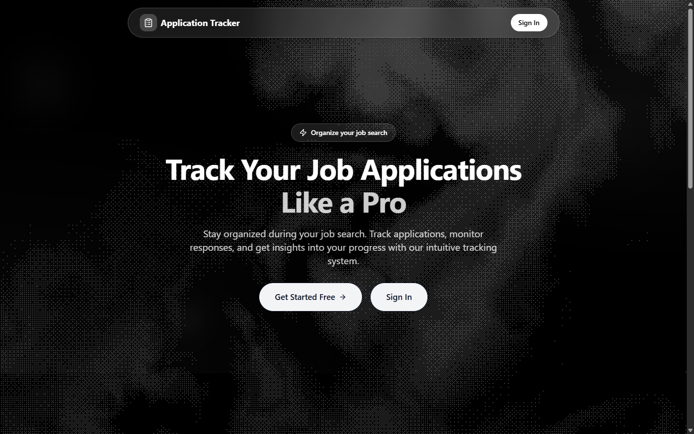
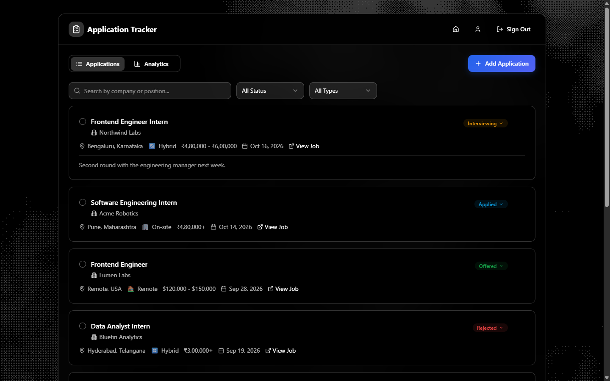
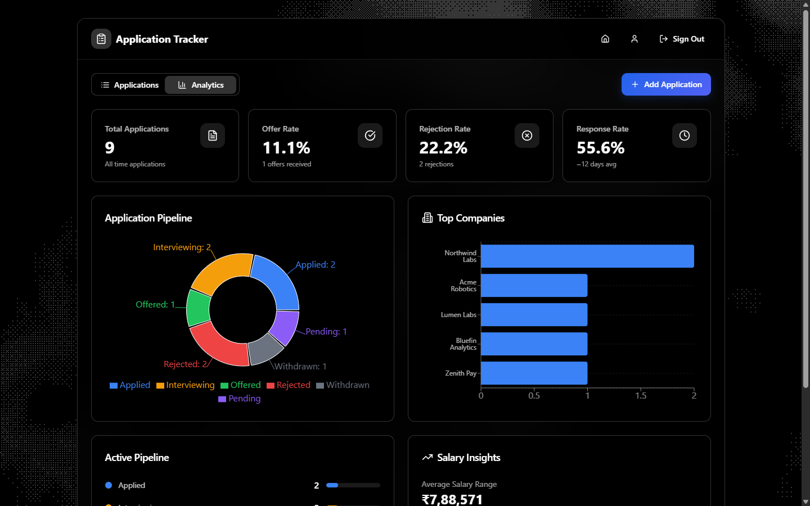
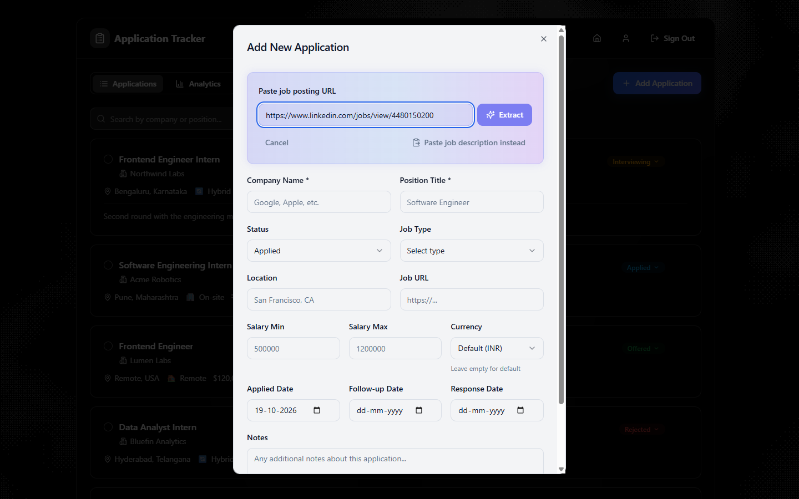
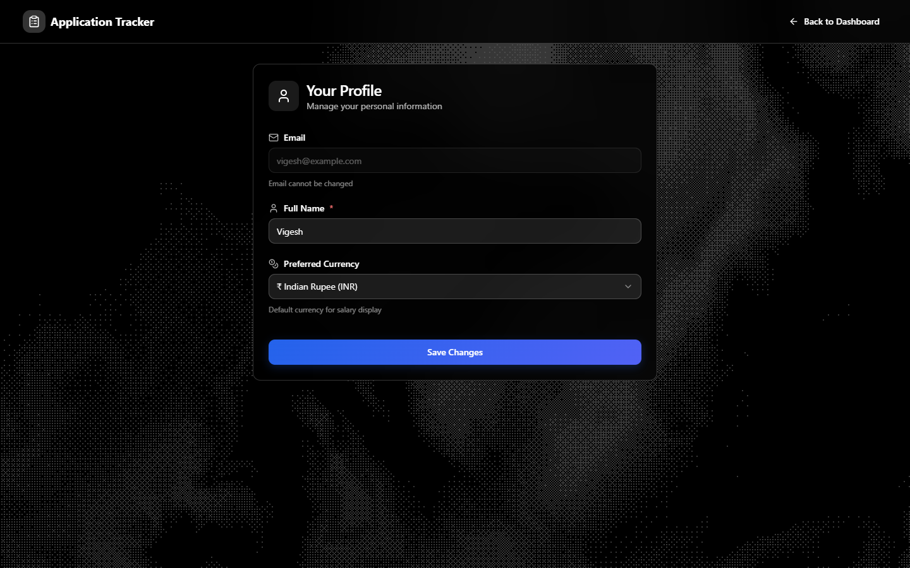
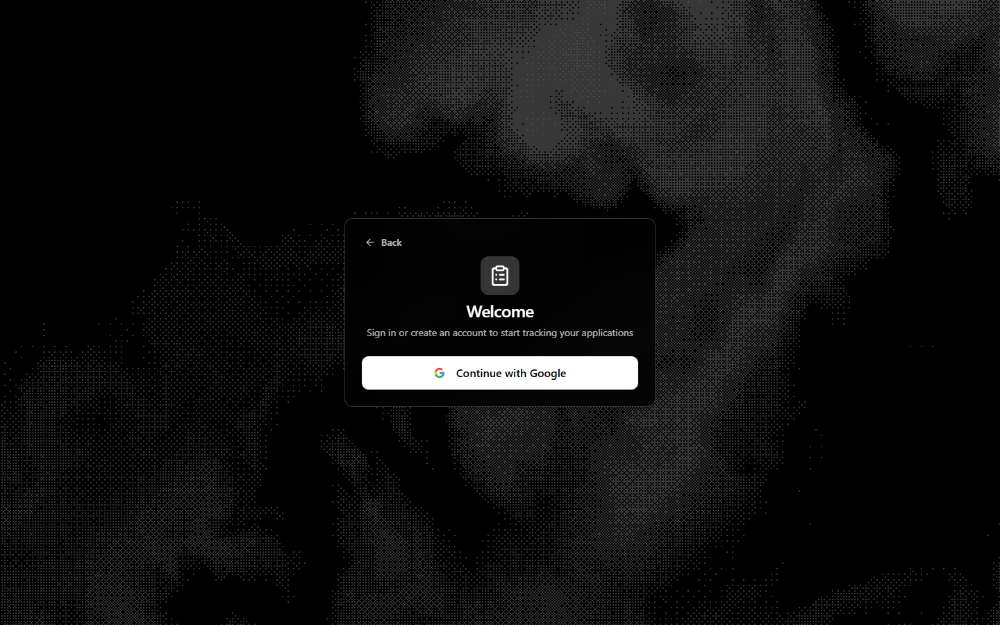
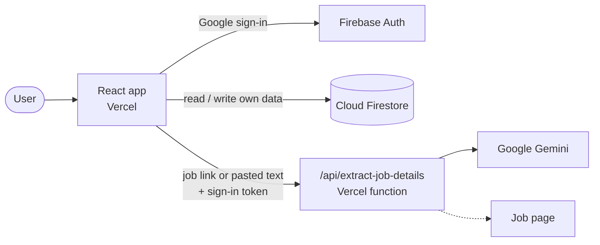
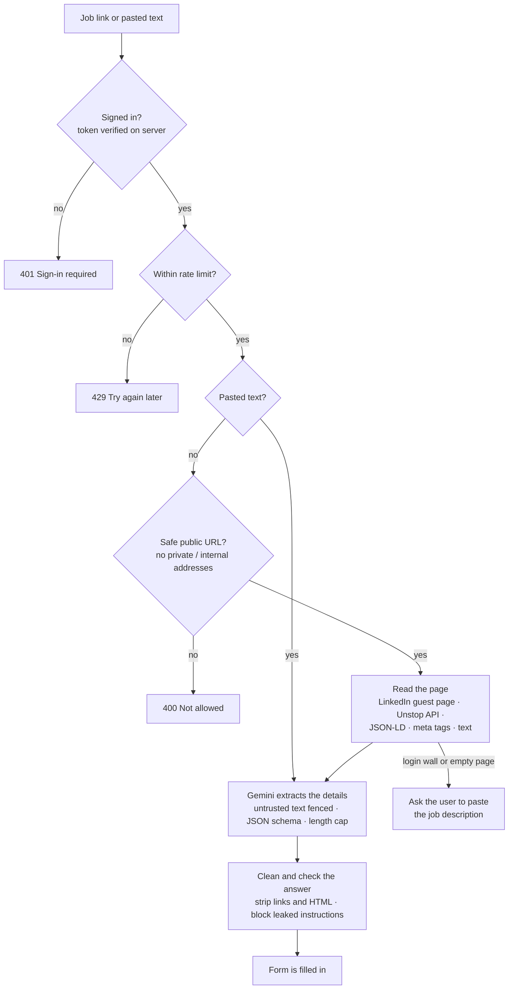

# 📋 Application Tracker

Track job and internship applications in one place. Paste a job link and the form fills itself with AI, follow every application through your pipeline, and see your response, offer and rejection rates at a glance.




## Screenshots

| Dashboard | Analytics |
|---|---|
|  |  |

| Add an application (Import from URL) | Profile |
|---|---|
|  |  |

<details>
<summary>Sign-in page</summary>


</details>

*Screenshots use sample data.*

## Features

- **Sign in with Google**, with a profile for your name and preferred currency.
- **Applications**: company, position, status, job type, location, salary range and currency, job link, notes, and applied / follow-up / response dates.
- **Import from URL**: paste a LinkedIn, Internshala, Unstop, Greenhouse, Lever or company careers link and Gemini fills in the form. For sites that can't be read automatically (login walls, JavaScript-only pages such as Naukri), paste the job description instead.
- **Search and filters** by company, position, location, status and job type.
- **Bulk actions**: change status or delete many applications at once.
- **Analytics**: totals, offer / rejection / response rates, average response time, pipeline chart, top companies, top locations, average salary.
- **8 currencies**: INR, USD, EUR, GBP, AED, SGD, CAD, AUD.
- **Admin dashboard**: every user's application counts per status, new and active users.

## How it works



**Import from URL**



## Tech stack

| Part | Technology |
|---|---|
| Frontend | React 18, TypeScript, Vite, Tailwind CSS, shadcn/ui (Radix), TanStack Query, Recharts |
| Background | WebGL2 dithered waves, rendered in a Web Worker (OffscreenCanvas) |
| Auth and database | Firebase Authentication (Google), Cloud Firestore with security rules |
| AI import | Vercel serverless function, Google Gemini API |
| Tests | Vitest, Testing Library |

Everything runs on free tiers.

## Getting started

Requires Node.js 20+.

### 1. Firebase
1. Go to <https://console.firebase.google.com> → **Add project**.
2. **Build → Authentication → Get started → Sign-in method → Google → Enable → Save.**
3. **Build → Firestore Database → Create database** → pick a location → **Production mode**.
4. **Firestore → Rules** → paste the contents of [`firestore.rules`](firestore.rules) → **Publish**.
5. **Project settings → General → Your apps → Web (`</>`)** → register an app → copy the `firebaseConfig` values.

### 2. Gemini
Get a free API key at <https://aistudio.google.com/apikey>.

### 3. Configure and run
```bash
npm install
cp .env.example .env    # then fill in the values
npm run dev
```
Open <http://localhost:8080>. `npm run dev` also runs the import API.

| Variable | Required | Purpose |
|---|---|---|
| `VITE_FIREBASE_API_KEY`, `VITE_FIREBASE_AUTH_DOMAIN`, `VITE_FIREBASE_PROJECT_ID`, `VITE_FIREBASE_STORAGE_BUCKET`, `VITE_FIREBASE_MESSAGING_SENDER_ID`, `VITE_FIREBASE_APP_ID` | yes | Firebase web app config (public identifiers) |
| `GEMINI_API_KEY` | yes | Import from URL (server only, never sent to the browser) |
| `GEMINI_MODEL` | no | Defaults to `gemini-3.5-flash-lite` |
| `FIRECRAWL_API_KEY` | no | Optional scraping service, tried before the direct page read |

### 4. Make yourself admin (optional)
1. Sign in once, then copy your **User UID** from Firebase → **Authentication → Users**.
2. **Firestore → Start collection** `admins` → Document ID = your UID → any field (e.g. `email`) → Save.
3. Reload the app: an **Admin** button appears. Admins can only be added from the console.

## Deploy to Vercel

1. Import this repository in Vercel (the Vite framework is detected automatically).
2. **Settings → Environment Variables**: add every variable from your `.env`.
3. Deploy, then in Firebase: **Authentication → Settings → Authorized domains → Add domain** → your Vercel domain.

## Security and privacy

**Database** ([`firestore.rules`](firestore.rules)): users can only read and write their own profile and applications. Field types and allowed values are validated. Profiles can't be deleted and email can't be changed. Admins get read-only access for the admin dashboard, and nobody can make themselves admin.

**Import API** (`api/_lib/extract.ts`):
- Every request needs a valid Firebase sign-in token, checked on the server.
- Rate limit per user: 10 imports a minute, 100 a day (kept in server memory, so it resets when Vercel starts a new instance; Gemini's free-tier quota is the hard limit).
- Links to private or internal addresses are refused, also after DNS lookup and on every redirect (SSRF protection).
- Request bodies are capped at 200 KB and pages at 3 MB, read as a stream, so huge or compressed "bomb" responses can't exhaust memory. Links to files (PDFs, images) are refused.
- Prompt-injection guardrails: the extraction rules are sent as Gemini's system instruction, the page text is fenced in tags it cannot close, answers that repeat the instructions are blocked, links / images / HTML are stripped from answers and the answer length is capped.
- Same-origin only (no CORS headers); responses are `no-store` and `nosniff`.

**Website**: `vercel.json` sets a Content-Security-Policy, `X-Frame-Options`, `X-Content-Type-Options`, `Referrer-Policy`, `Permissions-Policy` and HSTS. `npm run preview` serves the same headers. Job links are only clickable when they are real `http(s)` addresses.

**Privacy**:
- Stored in Firestore: your Google email, name, preferred currency and the applications you add, until you delete them.
- Sent to Google Gemini when you use *Import from URL*: the job page text or the text you paste. The Gemini API free tier may use this data to improve Google's products, so don't paste private information. Firecrawl also sees the job link if `FIRECRAWL_API_KEY` is set.
- Server logs contain no links or page text, only the step and error codes.

**Dependencies**: `npm audit --omit=dev` only reports advisories in build tools (the Tailwind CSS 3 toolchain, never shipped to the browser) and one React Router advisory about navigating to user-supplied paths, which this app never does.

## Performance

Measured on the production build:

| Metric | Before | After |
|---|---|---|
| JavaScript downloaded on first visit (gzip) | 534 KB | 180 KB |
| Lighthouse mobile, landing page | 50 | 73–87 |
| Lighthouse desktop, landing page | 68 | 100 |
| Idle frame rate | 34 fps | 60 fps |

Details in [`docs/PROGRESS.md`](docs/PROGRESS.md).

## Scripts

| Command | What it does |
|---|---|
| `npm run dev` | App + API at http://localhost:8080 |
| `npm run build` | Production build into `dist/` |
| `npm run preview` | Serve the production build with the production security headers |
| `npm test` | Unit tests (security guardrails, URL safety, page parsing, AI import flow, data loading) |
| `npm run typecheck` | TypeScript check for app, API and config |
| `npm run lint` | ESLint |
| `npm run import-data` | One-time import of Supabase CSV exports ([`docs/MIGRATION.md`](docs/MIGRATION.md)) |

## Project structure

```
api/
  extract-job-details.ts     Vercel function entry
  _lib/extract.ts            AI import logic and guardrails (shared with npm run dev)
src/
  lib/firebase.ts            Firebase app + Auth
  lib/firestore.ts           Firestore (loaded only when signed in)
  lib/auth.tsx               Google sign-in
  lib/profileStore.ts        profile read (created on first sign-in) / update
  hooks/                     applications, profile, admin, currency
  components/Dither.tsx      animated background; WebGL code in components/dither/
  components/, pages/        UI
  test/                      unit tests
docs/
  ARCHITECTURE.md            how the app is built
  PROGRESS.md                changes, measurements, known limits
  MIGRATION.md               moving data from the old Supabase version
firestore.rules              database security rules
vercel.json                  routing and security headers
```

## Troubleshooting

- **"This domain is not authorised"** when signing in: add the domain under Firebase → Authentication → Settings → Authorized domains (`localhost` is there by default).
- **Sign-in popup closes immediately**: allow popups for the site.
- **"Missing or insufficient permissions"**: the rules from `firestore.rules` weren't published, or the Firestore database wasn't created.
- **Import says the site blocked it, needs a login or uses JavaScript**: the dialog switches to *Paste job description*. Copy the posting text from the site and paste it there.
- **Import errors in general**: the message names the step that failed. `npm run dev` (or Vercel → Logs) shows one line per step.
- **"Gemini model not found"**: set `GEMINI_MODEL` to a current Flash or Flash-Lite model from <https://ai.google.dev/gemini-api/docs/models>.

## Author

**Vigesh** · [GitHub @Vigesh-VS](https://github.com/Vigesh-VS)
